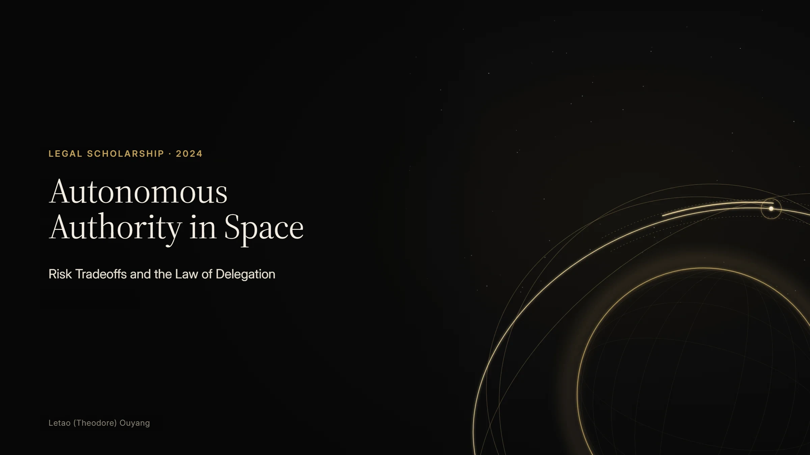
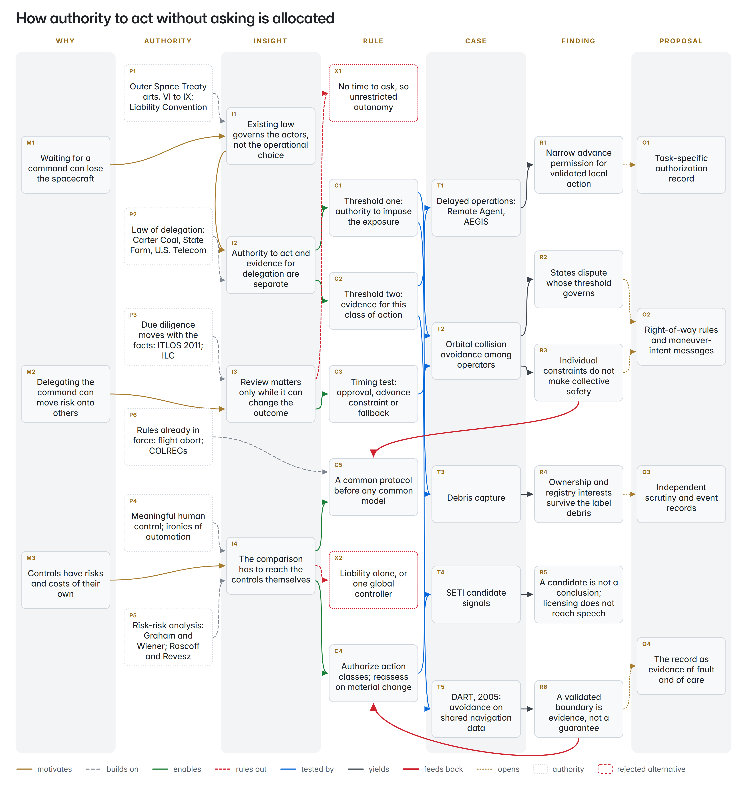

# Autonomous Authority in Space: Risk Tradeoffs and the Law of Delegation

**Letao (Theodore) Ouyang** · Duke Law School · December 2024; revised November 2026

[Article](manuscript/autonomous-authority-in-space.md) · [PDF](paper/paper.pdf) · [Argument map](docs/argument-map.md) · [Proposal](docs/proposal.md) · [Research route](docs/research-route.md) · [Literature](docs/literature.md)

**When may a space system act without contemporaneous human approval, and which institution decides that it may?**

A spacecraft sometimes has to act before anyone on the ground can approve the command, and waiting has risks of its
own. A satellite can avoid one collision by moving into a trajectory that raises another operator's risk. This
Article argues that supervision should distinguish lawful authority to undertake an activity from evidence that
justifies its autonomous execution, and it proposes a two-threshold decision procedure and a task-specific
authorization record that implement the distinction. The two thresholds and the timing test restate, for
autonomous systems, what the law of delegation already asks of human delegates: authority first, a justification
on the record, and control exercised while it can still matter.

## Three claims to start with

| Claim | Why it matters | Where |
| --- | --- | --- |
| **Authority and evidence are separate thresholds, and timing is a third question.** Only when an actor has authority to impose an exposure, and evidence justifies delegating this class of action, does the question become when human review can still change the outcome | "No time to ask" stops being an argument for unrestricted autonomy. It supports advance-constrained action or a justified fallback | [Part II](manuscript/autonomous-authority-in-space.md) · [Argument map](docs/argument-map.md#part-ii-from-risk-classification-to-a-comparative-decision-procedure) |
| **The procedure is the law of delegation, applied to software.** The first threshold is the rule against private power over rivals (*Carter Coal*), the second is reasoned decision on a record (*State Farm*), and the timing test is the rule that a retained final decision must be exercised in time (*U.S. Telecom*) | The proposal asks nothing of an autonomous system that the law does not already ask of a human delegate, and it tells a reviewing court what to look for | [Part II.C](manuscript/autonomous-authority-in-space.md) · [Proposal](docs/proposal.md#1-the-two-threshold-screen) |
| **An authorization record connects supervision before the event to liability after it.** Departure from a documented operating range is evidence of fault, and operation within it is evidence of care without being a defense | The fault standard of the Liability Convention has lacked an account of the precautions that were available. The record supplies it | [Part VII.C](manuscript/autonomous-authority-in-space.md) · [Proposal](docs/proposal.md#5-the-records-legal-effect) |

## The problem

Autonomous space systems need rules that allocate authority among states, operators and reviewers. Waiting for a
command may expose a spacecraft to avoidable loss. Delegating the command may let its operator impose risks on
others. The space treaties supply responsibility, continuing supervision, liability and due regard, and they
prescribe no control architecture: nothing in them says when a human must approve, what collision threshold
governs, or what record an operator keeps. In 2021 that gap produced a dispute between states. China reported that
its space station had twice maneuvered to avoid Starlink satellites, the second time a satellite whose "manoeuvre
strategy was unknown", and the United States answered that the encounters did not meet its emergency criteria. The
two states did not disagree about physics. They disagreed about whose threshold governed.

## The argument in brief

1. **Risk-risk analysis has to reach the controls** (Part II). Approval, certification and disclosure have costs
   and benefits of their own, a risk category means nothing until the baseline, the endpoint and the population are
   fixed, and distribution is a separate question from aggregate benefit.
2. **Existing law governs the actors and leaves operational choices** (Part III). Continuing supervision is a duty
   of due diligence that moves with the facts, so reassessment triggers and revisable permissions are what it
   ordinarily requires.
3. **Delayed operations justify narrow advance permission** (Part IV). Flight experience supports task-specific
   action under safeguards set in advance, and United States launch regulation already delegates flight abort to
   pre-set limits.
4. **Orbital avoidance adds other operators** (Part V). A better prediction is one part of avoidance. A maneuver
   policy can move exposure onto a neighbor, individually safe systems do not add up to collective safety, and a
   common protocol comes before any common model. Capture adds ownership and registry interests that prediction
   cannot resolve.
5. **SETI marks the limit** (Part VI). A candidate is not a conclusion, and spacecraft licensing powers do not
   reach scientific speech; in the United States advance clearance of an announcement would be a prior restraint.
6. **Authority that can be revised** (Part VII). A task-specific authorization record, independent scrutiny and
   event records, placed in the institutions that have power to require them.
7. **Objections** (Part VIII). The record may conceal a political choice; regulation may favor incumbents; a
   validated boundary may fail outside its assumptions, as it did in NASA's DART mission; liability alone or a
   global controller might seem preferable. Each is answered on the comparison the Article sets up.

## Governing law, by weight

| Weight | Sources | What they settle | What they leave open |
| --- | --- | --- | --- |
| **Binding treaty law** | Outer Space Treaty arts. VI to IX; Liability Convention; Registration Convention | State responsibility and continuing supervision; registry jurisdiction and ownership; due regard; absolute and fault liability | Any cadence of human approval, any collision threshold, any operational record |
| **International decisions and codification** | ITLOS Seabed Disputes Chamber, Advisory Opinion (2011); ILC Articles on State Responsibility and on Prevention (2001) | Due diligence scaled to risk and changing with knowledge; fresh authorization for a major change | The seabed opinion is an analogy for space |
| **Binding domestic law (United States)** | 47 C.F.R. § 25.114(d)(14); 14 C.F.R. § 450.108; *Carter Coal*, *State Farm*, *U.S. Telecom*, *Loper Bright* | Disclosure of maneuverability; pre-set flight-abort rules; the limits of delegation and of agency authority | The reach of each agency beyond its statute |
| **State practice** | Notes verbales of China and the United States, U.N. Docs. A/AC.105/1262 and A/AC.105/1265 | That close approaches are framed in Article VI terms | Whose threshold governs |
| **Soft law** | COPUOS Long-term Sustainability Guidelines (2019); IAA SETI Declaration of Principles (2010) | Voluntary practices and professional commitments | Binding force |

## What the Article contributes

1. **A decision procedure with two thresholds and a timing test**, in place of the question whether a system is
   "autonomous". Individual approval, advance-constrained action and a justified fallback are treated as three
   different supervisory choices.
2. **The doctrinal pedigree of that procedure in the law of delegation**, which gives courts and agencies a
   familiar standard for an unfamiliar technology.
3. **Risk-risk analysis applied to the regulation itself**, in both directions: the costs of approval and
   certification, and the ancillary benefits that tradeoff analysis tends to leave out.
4. **A reading of continuing supervision as due diligence that moves with the facts**, drawn from the Seabed
   Disputes Chamber and the International Law Commission's prevention articles.
5. **The task-specific authorization record**, with its fields, its reassessment triggers and its evidentiary
   effect under a fault standard.
6. **Protocol before model.** A licensing condition should ask for interoperable right-of-way rules and
   maneuver-intent messages before it asks for any particular prediction model.

[Where this Article sits](docs/literature.md) sets these against the space-law, human-control and risk-regulation
literatures, and the [bibliography](docs/bibliography.md) lists all 159 authorities and sources.

## The proposal

Before any record, a screen: does the actor have **authority** to impose this exposure, does the **evidence**
justify delegating this class of action under these conditions, and can individual **review** still change the
outcome? Then a record that states the responsible actor, the action class, the operating conditions, the exposed
interests, the alternatives considered, the fallback and the triggers for reassessment, with independent scrutiny
before the permission and an event record after it. The [proposal](docs/proposal.md) sets the record out as a
template and applies it to instrument targeting, collision avoidance, debris capture and SETI.

## How the argument was built

<picture>
  <source media="(prefers-color-scheme: dark)" srcset="assets/route-dark.png">
  
</picture>

The route is a network. The thresholds, the cases and the instruments were worked out against each other, and two
findings went back and changed a rule.

- **What the law already settles.** The treaties govern the actors, so the open question is what a delegation
  requires, and the law of delegation answers it.
- **When review still matters.** A veto that cannot be exercised in time is kept in name only, which rules out the
  argument from urgency.
- **Five cases.** Collision avoidance showed that individually safe systems do not make collective safety, so the
  licensing condition starts from a protocol. DART showed that a validated boundary is evidence and not a
  guarantee, and the permission is reassessed when its assumptions fail.

The [research route](docs/research-route.md) explains all 35 steps and all 36 links.

## Repository

| Path | Contents |
| --- | --- |
| [`manuscript/`](manuscript/autonomous-authority-in-space.md) | The Article, with its notes |
| [`paper/paper.pdf`](paper/paper.pdf) | The Article as a PDF |
| [`docs/argument-map.md`](docs/argument-map.md) | Each claim, the authority it rests on, the strongest objection and the response |
| [`docs/proposal.md`](docs/proposal.md) | The two-threshold screen and the authorization record as a template |
| [`docs/research-route.md`](docs/research-route.md) | The logic of the Article as a network, node by node |
| [`docs/literature.md`](docs/literature.md) · [`docs/bibliography.md`](docs/bibliography.md) | Where the Article sits, and the 159 authorities and sources |

## Citation

Letao (Theodore) Ouyang, *Autonomous Authority in Space: Risk Tradeoffs and the Law of Delegation* (Duke Law School,
2024), <https://www.theodoreoy.com/experience/autonomous-authority-in-space/>. See [CITATION.cff](CITATION.cff).

[theodore.oy2025@gmail.com](mailto:theodore.oy2025@gmail.com) · [10@alumni.duke.edu](mailto:10@alumni.duke.edu)

© Letao (Theodore) Ouyang. All rights reserved.
