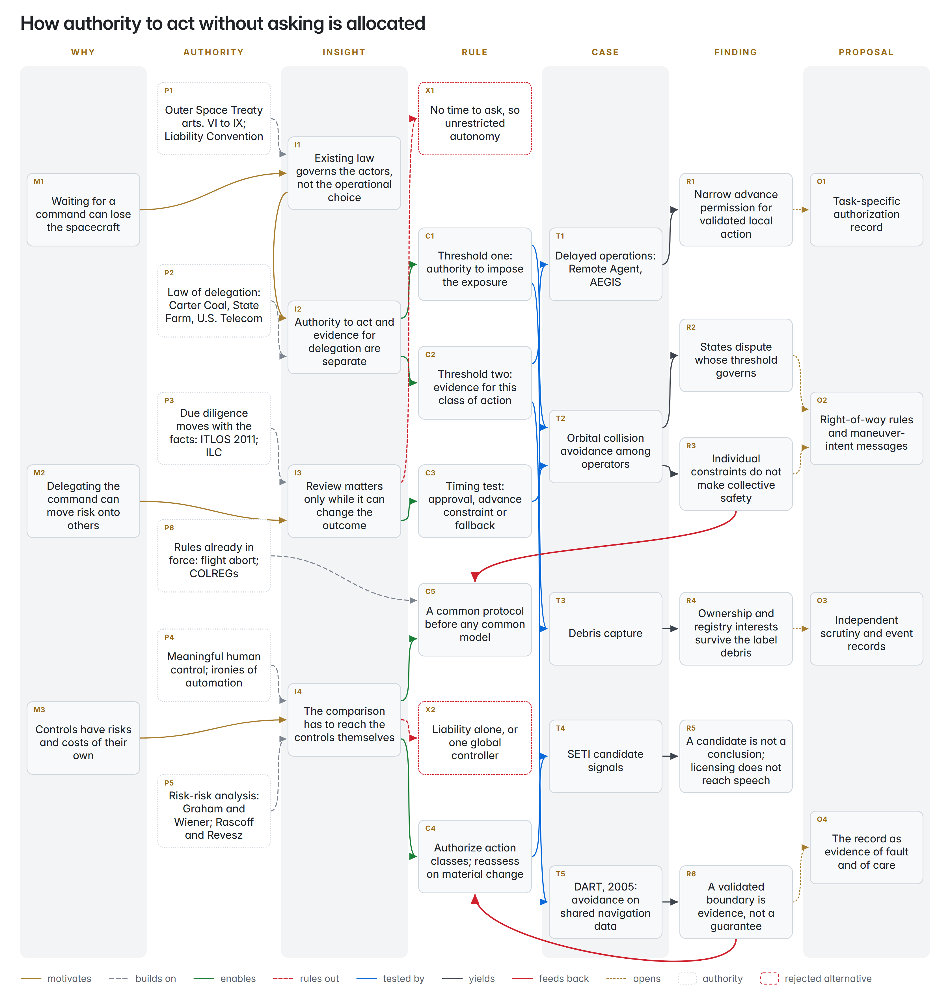

# Research route

How the argument was built: which body of authority supports which step, where a case went back and changed a
rule, and what the rules become as instruments. The Article does not run from problem to solution in one line. The
thresholds, the cases and the instruments were worked out against each other, because a rule about delegation is
only as good as the cases it can decide.

<picture>
  <source media="(prefers-color-scheme: dark)" srcset="../assets/route-dark.png">
  
</picture>

## Reading the figure

Columns are kinds of step, not stages in time. A link can run between any two columns, and two run backwards, from
a finding to a rule.

| Link | Meaning |
| --- | --- |
| motivates | A problem or an insight that made the next step necessary |
| builds on | An authority the step rests on |
| enables | A step that makes another one possible |
| tested by / yields | A rule and the case that tests it; a case and what it shows |
| feeds back | A finding that changed a rule |
| rules out | A step that excludes an alternative |
| opens | A finding that becomes an instrument |

Solid boxes are the Article's own steps. Dotted boxes are authority, and red dashed boxes are positions the Article
rejects.

## The four threads

### 1. What the law already settles

M1 → I1 → I2 → C1, C2.

A spacecraft sometimes has to act before anyone on the ground can approve the command (M1). The space treaties
govern the actors and leave that operational choice open (I1): they supply responsibility, continuing supervision,
liability and due regard (P1), and prescribe no cadence of approval. The open question is what a delegation
requires, and the answer separates two things (I2). Lawful authority to undertake an activity and impose its
exposure is the first threshold (C1). Evidence that justifies delegating this class of action under these
conditions is the second (C2). The law of delegation among human institutions draws the same line (P2): a private
actor may not be given power over its rivals, and a delegation is justified on a record.

### 2. When review still matters

M2 → I3 → C3, with I3 ruling out X1.

Delegating a command can move risk onto others (M2), so those others have an interest in when review happens.
Individual review is valuable only while it can change the outcome (I3). Continuing supervision is a duty that
moves with the facts (P3), and where review cannot change the outcome the principal's judgment has to be exercised
earlier and in bounded terms. The timing test (C3) therefore distinguishes individual approval, advance-constrained
action and a justified fallback. "No time to ask" is a reason for the second or the third and never for
unrestricted autonomy (X1).

### 3. The comparison reaches the controls

M3 → I4 → C4, C5, with I4 ruling out X2.

Controls have risks and costs of their own (M3). Risk-risk analysis compares a technology with its alternatives
(P5); the Article applies the comparison to the regulation as well (I4), against feasible baselines and in both
directions. Compared that way, neither liability alone nor a single global controller dominates (X2). What does is
authorization by class of action, with renewed justification when material assumptions change (C4), and a common
protocol for who moves and how intentions are signaled before any common model is mandated (C5), as sea and air
traffic already do (P6).

### 4. Five cases

C1, C2, C3, C4 → T1 to T5 → R1 to R6, with R3 and R6 feeding back.

- **Delayed operations (T1).** Flight experience with Remote Agent and AEGIS supports narrow advance permission
  for validated local action (R1).
- **Orbital collision avoidance (T2).** State practice shows that states dispute whose threshold governs (R2), and
  individually safe systems do not add up to collective safety (R3). That finding went back into the rules
  (R3 → C5): a licensing condition starts from an interoperable protocol.
- **Debris capture (T3).** Ownership and registry interests survive the label "debris" (R4), so target identity
  and legal permission are settled before close approach.
- **SETI (T4).** A candidate is not a conclusion, and spacecraft licensing powers do not reach scientific speech
  (R5).
- **DART (T5).** A collision-avoidance function that shared the guidance system's navigation data failed with it
  (R6). A validated boundary is evidence and not a guarantee, which went back into the authorization rule
  (R6 → C4): the permission is reassessed when its assumptions fail.

## From findings to instruments

| Instrument | Comes from | What it does |
| --- | --- | --- |
| O1 Task-specific authorization record | R1 | States the actor, the action class, the operating conditions, the exposed interests, the alternatives, the fallback and the reassessment triggers ([template](proposal.md)) |
| O2 Right-of-way rules and maneuver-intent messages | R2, R3 | Answers in advance whose threshold governs, and states coordination before prediction |
| O3 Independent scrutiny and event records | R4 | Reviewers who can challenge the baseline, and records from which a consequential decision can be reconstructed |
| O4 The record as evidence of fault and of care | R6 | Connects supervision before the event to liability after it |

## Every node

| Node | Column | What it is |
| --- | --- | --- |
| **M1** Waiting for a command can lose the spacecraft | Why | A spacecraft sometimes has to act before anyone on the ground can approve the command, and waiting has risks of its own. |
| **M2** Delegating the command can move risk onto others | Why | A satellite can avoid one collision by moving into a trajectory that raises another operator's risk. |
| **M3** Controls have risks and costs of their own | Why | Approval, certification and disclosure can make safe action slower and more expensive, and can create hazards. |
| **P1** Outer Space Treaty arts. VI to IX; Liability Convention | Authority | Responsibility, authorization and continuing supervision, registry jurisdiction, due regard and liability. No control architecture is prescribed. |
| **P2** Law of delegation: Carter Coal, State Farm, U.S. Telecom | Authority | No private power over rivals; a decision justified on a record; subdelegation with the final decision retained. |
| **P3** Due diligence moves with the facts: ITLOS 2011; ILC | Authority | Due diligence is a variable concept, and a major change requires fresh authorization. |
| **P6** Rules already in force: flight abort; COLREGs | Authority | 14 C.F.R. § 450.108 delegates a drastic action to pre-set limits; the collision regulations assign who gives way. |
| **P4** Meaningful human control; ironies of automation | Authority | Control can be exercised upstream of an action, and nominal oversight can be oversight no one can perform. |
| **P5** Risk-risk analysis: Graham and Wiener; Rascoff and Revesz | Authority | Countervailing risks, and the ancillary benefits that tradeoff analysis tends to leave out. |
| **I1** Existing law governs the actors, not the operational choice | Insight | The treaties supply responsibility, supervision, liability and due regard without prescribing when a human must approve. |
| **I2** Authority to act and evidence for delegation are separate | Insight | Lawful authority to undertake an activity is one question; evidence that justifies autonomous execution is another. |
| **I3** Review matters only while it can change the outcome | Insight | Individual approval is valuable before practical irreversibility, with information that can expose an error, by someone authorized to act. |
| **I4** The comparison has to reach the controls themselves | Insight | The baseline is a feasible workflow, and regulation is itself an object of comparison, in both directions. |
| **X1** No time to ask, so unrestricted autonomy | Rule | Rejected: lack of time justifies advance-constrained action or a justified fallback, never unrestricted autonomy. |
| **C1** Threshold one: authority to impose the exposure | Rule | The actor must hold authority to undertake the activity and impose its exposure on others. |
| **C2** Threshold two: evidence for this class of action | Rule | The evidence must justify delegating this class of action under these conditions. |
| **C3** Timing test: approval, advance constraint or fallback | Rule | Individual approval, advance-constrained action and a justified fallback are separate supervisory choices. |
| **C5** A common protocol before any common model | Rule | Interoperable right-of-way rules and maneuver-intent messages come before a mandated prediction model. |
| **X2** Liability alone, or one global controller | Rule | Rejected: liability works only for compensable and provable harms, and central control needs information and legitimacy it cannot assume. |
| **C4** Authorize action classes; reassess on material change | Rule | States authorize defined classes of action and require renewed justification when material assumptions change. |
| **T1** Delayed operations: Remote Agent, AEGIS | Case | Operations under communication delay, where some responses have to be local. |
| **T2** Orbital collision avoidance among operators | Case | Avoidance among many operators, including the 2021 close approaches reported to the United Nations. |
| **T3** Debris capture | Case | Close approach to and capture of an object that has an owner and a state of registry. |
| **T4** SETI candidate signals | Case | Machine-learning classifiers that flag candidate signals, and the signal blc1. |
| **T5** DART, 2005: avoidance on shared navigation data | Case | An autonomous rendezvous vehicle that collided with its target although its collision avoidance had activated. |
| **R1** Narrow advance permission for validated local action | Finding | Flight experience supports task-specific action under safeguards set in advance, with a fallback that is itself justified. |
| **R2** States dispute whose threshold governs | Finding | In the 2021 and 2022 notes verbales China and the United States did not disagree about physics. They disagreed about whose threshold governed. |
| **R3** Individual constraints do not make collective safety | Finding | A license has to consider interactions, and a mandated common model could concentrate a shared error. |
| **R4** Ownership and registry interests survive the label debris | Finding | Target identity and legal permission are settled before close approach; execution limits and abort are authorized in advance. |
| **R5** A candidate is not a conclusion; licensing does not reach speech | Finding | Confirmation is a matter for scientific verification, and advance clearance of an announcement would be a prior restraint. |
| **R6** A validated boundary is evidence, not a guarantee | Finding | The collision-avoidance logic depended on the same navigation data as the guidance system. Independence is judged against real failure paths. |
| **O1** Task-specific authorization record | Proposal | Actor, action class, operating conditions, exposed interests, alternatives, fallback and reassessment triggers. |
| **O2** Right-of-way rules and maneuver-intent messages | Proposal | A licensing condition asks for an interoperable protocol before it asks for any particular model. |
| **O3** Independent scrutiny and event records | Proposal | Reviewers who can challenge the baseline and the excluded scenarios, and records from which a consequential decision can be reconstructed. |
| **O4** The record as evidence of fault and of care | Proposal | Departure from the documented range is evidence of fault; operation within it is evidence of care, without being a defense. |

## Every link

| # | From | To | Link | Why |
| ---: | --- | --- | --- | --- |
| 1 | P1 | I1 | builds on | The treaties allocate responsibility and leave the cadence of approval open |
| 2 | M1 | I1 | motivates | If waiting can be the dangerous choice, the law has to say who may act |
| 3 | I1 | I2 | motivates | With the actors settled, the open question is what a delegation requires |
| 4 | P2 | I2 | builds on | Delegation among human institutions already separates power from its justification |
| 5 | I2 | C1 | enables | Authority comes first and evidence cannot cure its absence |
| 6 | I2 | C2 | enables | Evidence is assessed for a class of action under stated conditions |
| 7 | M2 | I3 | motivates | A neighbor exposed to the maneuver has an interest in when review happens |
| 8 | P3 | I3 | builds on | Supervision is a continuing duty that changes with knowledge and risk |
| 9 | I3 | C3 | enables | Where review cannot change the outcome, judgment is exercised earlier and in bounded terms |
| 10 | I3 | X1 | rules out | A retained veto that cannot be exercised in time is no reason to drop the limits |
| 11 | P4 | I4 | builds on | Oversight that cannot be performed adds risk without adding control |
| 12 | M3 | I4 | motivates | A control is a choice with consequences |
| 13 | P5 | I4 | builds on | Risk-risk method, applied to regulation as well as to technology |
| 14 | I4 | C4 | enables | Authorization by class costs less than approval by action and keeps the state able to act on change |
| 15 | I4 | X2 | rules out | Compared against feasible baselines, neither liability alone nor central control dominates |
| 16 | P6 | C5 | builds on | Sea and air traffic assign who moves and leave prediction to each participant |
| 17 | C2 | T1 | tested by | What flight experience can and cannot establish |
| 18 | C1 | T2 | tested by | An operator's maneuver policy imposes exposure on its neighbors |
| 19 | C3 | T2 | tested by | Whether review of a single maneuver can still matter |
| 20 | C1 | T3 | tested by | Capture needs a legal permission that prediction cannot supply |
| 21 | C4 | T4 | tested by | Whether the procedure extends beyond spacecraft |
| 22 | T1 | R1 | yields | Task-specific action under pre-set safeguards |
| 23 | T2 | R2 | yields | State practice on close approaches |
| 24 | T2 | R3 | yields | Interaction among individually safe systems |
| 25 | T3 | R4 | yields | The legal interest in the target |
| 26 | T4 | R5 | yields | The limit of borrowed licensing powers |
| 27 | T5 | R6 | yields | A failure that occurred in flight |
| 28 | R3 | C5 | feeds back | Collective safety needs a protocol, so the licensing condition starts there |
| 29 | R1 | O1 | opens | The permission is written down by task |
| 30 | R2 | O2 | opens | The record answers in advance whose threshold governs |
| 31 | R3 | O2 | opens | Coordination is stated before prediction |
| 32 | R4 | O3 | opens | Authority and plan are reviewed before execution |
| 33 | R6 | O4 | opens | A reconstructed decision is what a fault standard needs |
| 34 | I4 | C5 | enables | A mandated common model is itself a control, and it could concentrate a shared error |
| 35 | C2 | T5 | tested by | A protection validated on the controller's own data |
| 36 | R6 | C4 | feeds back | Operating ranges rest on evidence, so the authorization is reassessed when its assumptions fail |
